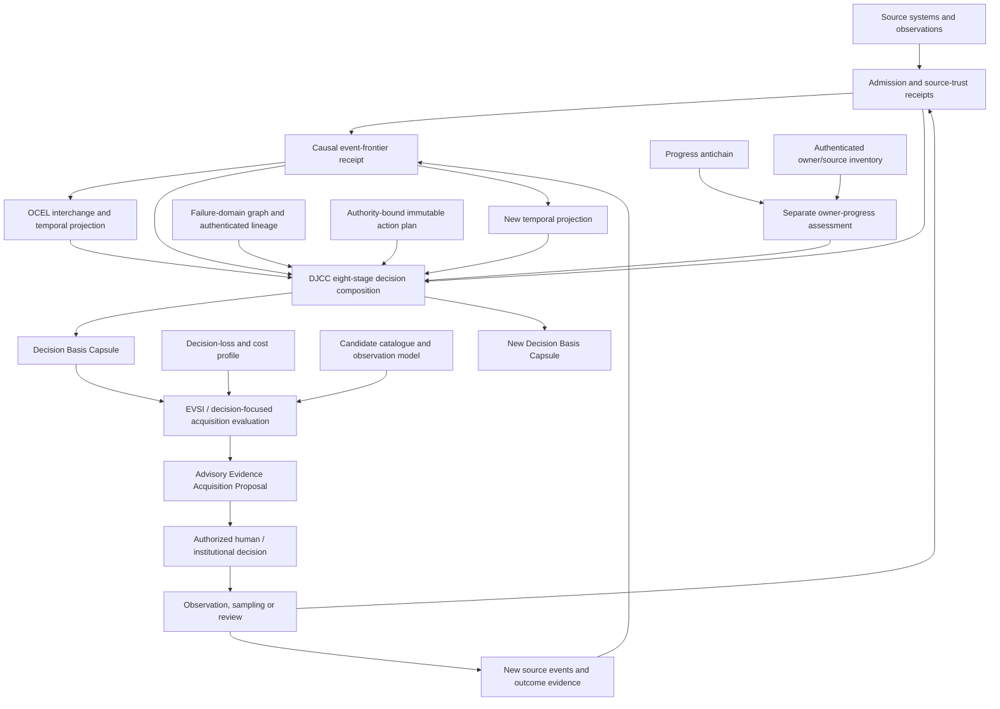

# Craft Assurance Architecture Map V1

**Parent:** temporal/evidence qualification PR #6825  
**Composition:** #6822 / #6827 / #6833 / #6835  
**Acquisition planning:** #6828 / #6829 / #6831 / #6843 / #6844  
**Comparator protocol:** #6841 / #6842

## 1. Architecture principle: one-way receipts, independently owned semantics

Craft should not become a monolithic trust service or a single database that silently assumes every assertion is true. Existing owner systems retain their responsibilities. Cross-core layers compose exact, versioned receipts and preserve claim ceilings.

The primary architecture is a directed acyclic assurance graph:

The diagram is a conceptual ownership graph, not an assertion that every owner API or field adapter has already been integrated or qualified.

## 2. Artifact boundaries

| Artifact | What it answers | Immutable bindings | It does not do |
|---|---|---|---|
| Source/admission receipt | What exact source statement or observation was admitted, and under which trust profile? | bytes/digest, issuer/key, registry epoch, verifier and source identity | Establish whole source-universe completeness or physical truth |
| Causal Event Frontier | Which per-stream source records and causal parents are included at this knowledge cut? | stream identity, epoch, contiguous prefix, head digest, parent closure | Infer causal order from timestamps, prove owners are complete or authenticate itself |
| Progress Antichain | Is there outstanding declared owner progress that can precede a requested cut? | owner universe reference, antichain, verifier/profile | Authenticate event logs or prove owner-universe completeness |
| Owner Universe Receipt | Which source/owner population is in scope, and what completeness evidence supports it? | inventory digest, frontier, admission/authentication and completeness evidence | Substitute for the event frontier or process projection |
| OCEL/Temporal Projection | What object/event/relationship state is visible at valid time and the accepted frontier? | OCEL profile, source corpus, valid time, frontier and projection receipt | Establish evidence truth, legal authority or complete source coverage by itself |
| DJCC Certificate | Do the eight exact evidence-to-outcome stages compose without widening their six claim ceilings? | profile, producer/consumer IDs, schema/digests, stage receipts, claim states | Reimplement source trust, policy, authority, execution or outcome owners |
| DBC | What exact evidence/policy/authority/plan/outcome basis supports this decision? | references to owner receipts, scope, frontier, action plan, claim ceiling | Store all source payloads or make the next measurement happen |
| EVSI Evaluation | Under a stated state model, loss profile and candidate set, what is expected decision value and acquisition cost? | model/evaluator/loss/candidate digests and decision/frontier context | Authenticate the model, acquire evidence or authorize effects |
| EAP | What advisory observation/review should be considered next, and why? | prior DBC digest/frontier, EVSI receipt, separate loss profile, candidate and observation-model digest, expiry/invalidation rules | Dispatch, authorize sampling, change plan denominator, publish advisories or close episodes |
| New DBC | After new evidence has been admitted and projected, what is now justified? | new source receipts, frontier, projection, DJCC composition and outcome | Rewrite the historical prior DBC or EAP |

## 3. Two different partial orders

Do not unify these as one generic "frontier" type.

**Causal event frontier:** a cut over per-stream append coordinates and verified causal-parent closure. It governs which event records may be visible in the distributed knowledge snapshot.

**Progress antichain:** a verifier-relative antichain over a declared owner-progress partial order. It governs whether declared progress points can still precede a query cut.

A locally valid event frontier can coexist with provisional progress. A stable progress antichain can coexist with an unauthenticated or incomplete owner universe. Neither structure proves the other.

The owner/source inventory must be admitted and qualified separately. Completeness requires the event frontier, progress state and owner-universe evidence to agree on exact digests and the same accepted scope.

## 4. Claim ceilings are monotone and dimension-specific

The six DJCC dimensions remain separate:

- Authentication
- Authority
- Completeness
- Effect
- Independence
- Truth

Examples of non-transfer:
- Authenticated statement does not prove lawful authority.
- A valid source prefix does not prove that every relevant source owner is registered.
- Structural failure-domain graph disjointness does not prove real-world independence.
- Process conformance does not prove factual truth.
- Action coverage does not prove execution.
- Execution acknowledgement does not prove physical effect.
- An EVSI score does not prove that a result will occur or that the decision will improve.

Downstream artifacts may narrow, preserve or make explicit a prior uncertainty. They cannot promote Rejected, Indeterminate, NotEvaluated or Unsupported claims into Established claims without the responsible upstream owner receipt and selected profile.

## 5. The DBC–EAP–new-DBC sequence is intentionally acyclic

Never embed an EAP inside the DBC that the EAP itself references.

1. DBC-N freezes the current justified basis at frontier F-N.
2. EVSI-N evaluates a named candidate set against DBC-N, a separate loss profile and the observation model.
3. EAP-N references the DBC-N digest and EVSI-N receipt; it is advisory-only, expiring and invalidated by frontier, scope, policy/loss, candidate or observation-model changes.
4. An authorized institution/person decides whether a proposal can proceed under safety, professional, legal, privacy and community constraints.
5. Any acquired observation becomes a new source statement with custody, provenance and trust evidence; it is not declared valid merely because the EAP forecast predicted it.
6. New admission and temporal projection produce F-N+1 and a new DBC-N+1.
7. Historical DBC-N and EAP-N remain unchanged. Realized EVSI can be measured by comparing predicted and observed decision value, not by retroactively modifying the proposal.

This avoids content-addressed cycles and preserves the difference between present assurance, recommended future work and later observed outcomes.

## 6. Unknown outcome and action-denominator invariants

- An unknown provider outcome blocks a new mutation in the same idempotency/effect scope until exact reconciliation.
- Every action observation and coverage receipt binds the immutable plan digest and revision. A plan amendment creates a new denominator; old observations do not migrate silently.
- Work completion, pressure restoration, water quality and service restoration are separate claims with their own evidence and qualified adjudicators.
- The EAP does not produce a work order. The DBC does not create a permit. The acquisition optimizer does not waive mandatory sampling.

## 7. Ownership and implementation sequence

1. Preserve each current owner API and schema. Do not duplicate temporal, trust, authority, action-denominator, execution or outcome logic in Craft.
2. Qualify the causal-frontier and EVSI reference oracles independently.
3. Qualify the DBC wire contract and exact receipt bindings.
4. Qualify EAP wire binding and advisory-only capability.
5. Add independent Rust/Go parity and mutation testing.
6. Run matched industry comparators on identical corpora, formats, hardware, cache state and repetition protocol.
7. Only then consider production adapter/zome integration behind privacy, authorization, professional, municipal and field qualification.

## 8. Current claim ceiling

The architecture map and reference oracles do not prove authenticated source completeness, legal authority, genuine evidence independence, water-quality compliance, repaired infrastructure, physical restoration or municipal service effectiveness. Those remain NotEvaluated until source owners, trust roots, professional adjudicators and field evidence are qualified.
